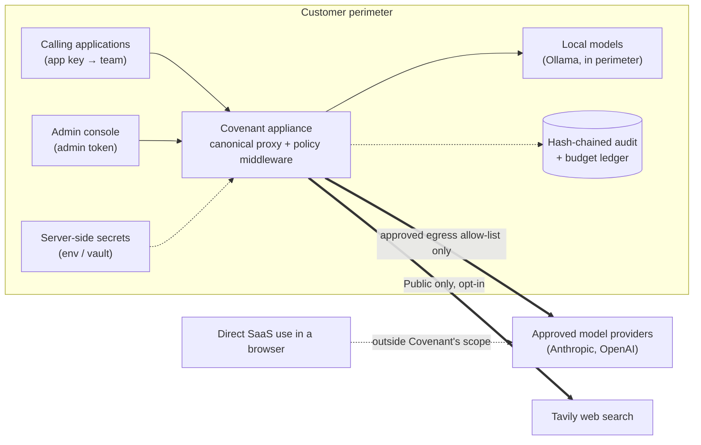
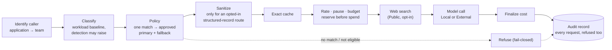

# Covenant

An in-perimeter **AI inference governance and FinOps control plane** for organizations that must show who used which model, with what data, where it ran and what it cost. Every LLM request passes through one governed pipeline: identified, classified, policy-routed, budget-checked, cost-attributed and audited — including the requests that get refused.

Research artifact: can inference governance be an architecturally separable control layer — enforceably, evidentially, and at acceptable cost?

**Start here:** [User guide](docs/user-guide.md) · [7-minute demo](docs/demo-7-minute.md) · [Console usage guide](docs/console-quickstart.md) · [Tavily setup](docs/web-search.md)

## Deployment and trust boundaries

Credentials stay on the server; the console never holds an application key or a provider key. Egress is limited to the
startup allow-list. Traffic that does not pass through Covenant (for example a browser talking to a SaaS chatbot) is not
governed by it; that needs network or endpoint controls.

## Request journey

The patterns are a canonical proxy with policy middleware, approved model routing with bounded fallback,
retrieval-augmented answers from one governed web search, an exact-match cache, and per-request attribution and
tamper-evident audit. Covenant does **not** rewrite prompts, does not judge answer quality, and has no learned quality
router. The optional length-based strategy is a deterministic size threshold (characters / 4), not a quality signal.
Sanitization (ADR-0016) applies only to a bounded structured record on a dedicated route. It is not anonymisation.

## Working principles

1. **Fail-closed.** No policy match → deny. Unclassified defaults to the most restrictive class. Misconfiguration → the appliance refuses to start. Raw PII/PHI never reaches a public provider. The one opt-in exception (ADR-0016) sends only a Covenant-built, sanitized payload of a bounded structured record for a dedicated PII workload; PHI and free text never qualify.
2. **Governance is the pipeline, not a bolt-on.** Every capability — classification, policy, budgets, attribution, audit — is an ordered stage in one middleware chain. Nothing bypasses it.
3. **Everything is evidence.** Each request, allowed or denied, appends exactly one hash-chained audit entry. Altering any past entry breaks every hash after it.
4. **The perimeter is sacred.** Deployed inside the customer boundary; egress only to approved model endpoints and explicitly enabled Public web search (ADR-0015); no phone-home.

## Where the detail lives

Architecture decisions: `docs/adr/` · code lineage: `docs/PROVENANCE.md` · area rules: `CLAUDE.md` files per directory · first-run instructions: `README-SCAFFOLD.md` (deleted once the build is stable).
