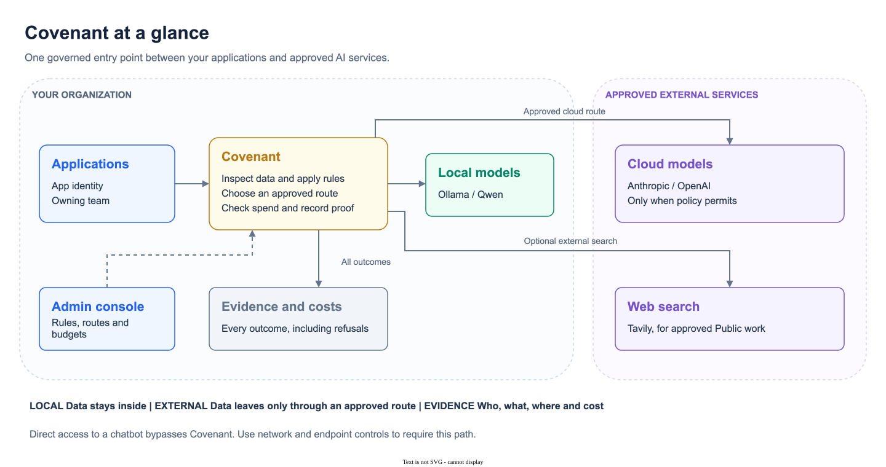

# Covenant

An in-perimeter **AI inference governance and FinOps control plane** for organizations that must show who used which model, with what data, where it ran and what it cost. Every LLM request passes through one governed pipeline: identified, classified, policy-routed, budget-checked, cost-attributed and audited; including the requests that get refused.

Research artifact: can inference governance be an architecturally separable control layer; enforceably, evidentially, and at acceptable cost?

**Start here:** [User guide](docs/user-guide.md) · [7-minute demo](docs/demo-7-minute.md) · [Console usage guide](docs/console-quickstart.md) · [Tavily setup](docs/web-search.md)

## System overview

Applications send AI requests through Covenant. It checks the caller, data, policy and budget before selecting an approved model. Local processing stays inside the organization. Cloud inference and web search cross the boundary only when permitted. Every outcome has an audit record and cost attribution.

[Edit the overview in Draw.io](docs/diagrams/covenant-overview.drawio)

## Request flow

The numbered flow shows the checks in execution order. A matching cache entry avoids a model call. A refusal stops further work, but earlier calls can still have a cost. The final record identifies the application, team, route, outcome and charges.

[Edit the detailed diagram in Draw.io](docs/diagrams/covenant-architecture.drawio)

**Architecture patterns:** canonical proxy, policy middleware, provider adapters, exact-match cache, governed retrieval and tamper-evident audit. Routing follows configured rules. Covenant does not evaluate answer quality or automatically rewrite prompts.

**Scope:** traffic must pass through Covenant to be governed. Direct chatbot access needs network or endpoint controls. Sensitive-data inspection is heuristic, not comprehensive DLP. The optional sanitized route accepts a narrow structured schema; it does not anonymize arbitrary prose or PHI.

Both diagrams use editable Draw.io shapes and connectors. The matching SVG images are generated from [the diagram source](docs/diagrams/gen_diagram.py).

## Working principles

1. **Fail-closed.** No policy match → deny. Unclassified defaults to the most restrictive class. Misconfiguration → the appliance refuses to start. Detected raw PII/PHI is excluded from public provider routes. The one opt-in exception (ADR-0016) sends only a Covenant-built, sanitized payload of a bounded structured record for a dedicated PII workload; PHI and free text never qualify.
2. **Governance is the pipeline, not a bolt-on.** Every capability; classification, policy, budgets, attribution, audit; is an ordered stage in one middleware chain. Nothing bypasses it.
3. **Everything is evidence.** Each request, allowed or denied, appends exactly one hash-chained audit entry. Altering any past entry breaks every hash after it.
4. **The perimeter is sacred.** Deployed inside the customer boundary; egress only to approved model endpoints and explicitly enabled Public web search (ADR-0015); no phone-home.

## Where the detail lives

Architecture decisions: `docs/adr/` · code lineage: `docs/PROVENANCE.md` · area rules: `CLAUDE.md` files per directory · first-run instructions: `README-SCAFFOLD.md` (deleted once the build is stable).
